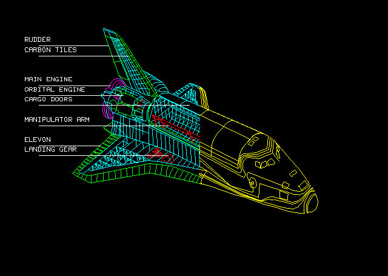
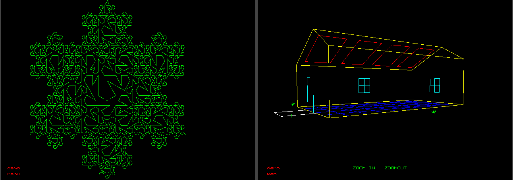
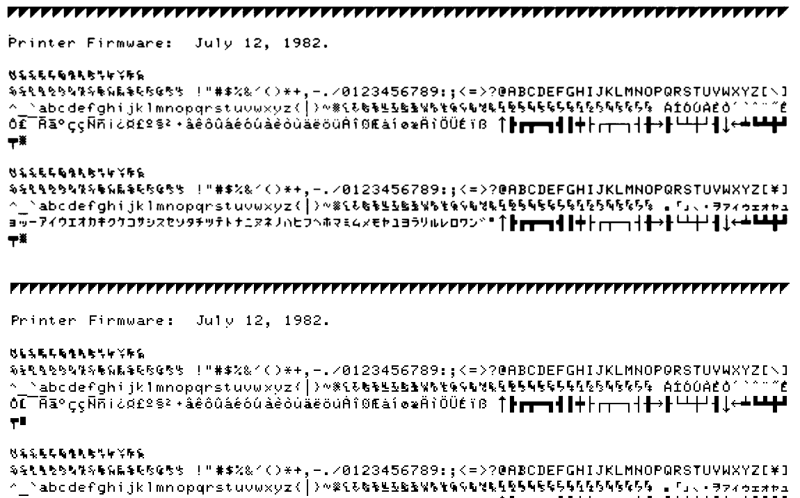

# hpfocus

This is an ongoing quest to attempt to emulate the HP 9000 Series Model 520
with the HP FOCUS microprocessor.

FOCUS, introduced in 1982, was the first commercial 32-bit microprocessor --
a microcoded, segmented, stack-oriented machine with no programmer-visible
general-purpose registers, implementing something similar to the HP 3000
architecture widened to 32 bits.

The goal is to run HP-UX and BASIC.

Both run now. The emulator is a [MAME](https://www.mamedev.org/) driver for
two of the Series 500 machines: the **9000/520**, a desktop workstation with
its own screen, keyboard and thermal printer, which ran HP BASIC, and the
**9000/540**, a free-standing system that ran HP-UX. No other emulation of
FOCUS is known to exist.

**Status: alpha.** It runs real HP software and is tested, and it still has
rough edges: see [KNOWN-ISSUES.md](KNOWN-ISSUES.md).

*A wireframe Space Shuttle from the `/graphics` directory of the HP-UX disc,
a 1984 graphics demo. Its own program needs HP-UX and a graphics terminal, so
here its points, colours and labels are drawn through HP BASIC on the
emulated 9000/520.*

*Two of HP's 1982 BASIC graphics demonstrations, `snow_flake` and `house`,
drawn by the emulated 9000/520.*

## What it runs

- **HP-UX 5.30 on the 9000/540**, from a 1991 backup of a real
  installation. It boots multiuser and takes logins on the console and on
  six terminal ports, and HP's own C compiler builds and runs programs.
- **HP BASIC 2.0 on the 9000/520**, on its own screen and keyboard, from
  HP's floppies or from a fixed disc, with graphics and the thermal
  printer (with the limits below).
- **HP's factory diagnostics for the 520**: the Test Supervisor, the
  display's self test, the graphics and the printer.
- **HP-UX 5.01 on the 520**, as far as its copyright banner: the surviving
  release tape is damaged and lost the rest.

*The 520's thermal printer self test: the CE Handbook's printout above, the
emulator's below. The emulator's printer font was read dot by dot off the
handbook's picture.*

HP-UX 5.30 coming up on the 540: everything its console printed from
power-on to the login prompt, captured from `tools/runhpux.sh --multiuser`
on a scratch copy of the disc.

    (c) Copyright 1983, 1984, 1985, 1986, 1987 Hewlett-Packard Company
    (c) Copyright 1979 The Regents of the University of Colorado, a body corporate
    (c) Copyright 1979, 1980, 1983 The Regents of the University of California
    (c) Copyright 1980, 1984 AT&T Technologies. All Rights Reserved.

                        RESTRICTED RIGHTS LEGEND

              Use,  duplication,  or disclosure by the Government  is
              subject to restrictions as set forth in subdivision (b)
              (3)  (ii)  of the Rights in Technical Data and Computer
              Software clause at 52.227-7013.

                        HEWLETT-PACKARD COMPANY
                            3000 Hanover St.
                          Palo Alto, CA  94303

    /etc/rc
    Thu Oct 29 20:00:24 PST 2026
    (c) Copyright 1983, 1984, 1985, 1986 Hewlett-Packard Co.
    (c) Copyright 1979 The Regents of the University of Colorado, a body corporate
    (c) Copyright 1979, 1980, 1983 The Regents of the University of California
    (c) Copyright 1980, 1984 AT&T Technologies.  All Rights Reserved.

                           RESTRICTED RIGHTS LEGEND

    Use, duplication, or disclosure by the Government is subject to restrictions
    as set forth in subdivision (b) (3) (ii) of the Rights in Technical Data and
    Computer Software clause at 52.227-7013.

                           HEWLETT-PACKARD COMPANY
                              3000 Hanover St.
                            Palo Alto, CA  94303

    logout
    unknown: adm logged out on Thu Oct 29 23:00:32 EST 2026
    system accounting started
    volumes mounted
    cron started
    talkdemon started
    line printer scheduler started
    preserving editor files (if any)
    removing lpd lock file (if any)
    cleaning up uucp
    NOTE:  Files in /tmp:
    total 2
    -rw-rw-rw-   1 root     root          10 Oct 29 20:00 sh60
    System:   HP-UX
    Release:  05.21
    Version:  B
    Machine:
    Identity: unknown
    Nodename: unknown

    HP-UX 5.30 (unknown)

    login:

*The dates are the host's, which MAME gives the machine at power-on. The
rest is that 1991 system's own: its `revision` command reports release
05.21, and the `logout` lines come from its accounting startup.*

## Digital archaeology

Digital archaeology results: very little survives for this machine! There's
a few disk images preserved by hpmuseum.net and a couple of tapes on
bitsavers, but that's it:

 * BASIC Language System 2.0
 * 9020 factory diagnostics
 * BASIC demo suite (all undamaged)
 * an HP-UX 5.01 system tape: truncated, most of the length is lost, but
   there does seem to be a complete kernel!
 * an HP-UX 5.3 disk image, a unit save of a 7914 disc: a live image from
   early 1991 of HP-UX 5.3 for FOCUS

The 5.30 image raised the stretch goal from "bring up a kernel" to booting
this system, and it now boots to multiuser.

This repository doesn't carry any of it: it is Hewlett-Packard's.
[MEDIA.txt](MEDIA.txt) lists every file the emulator uses, where it is
published and its checksum, and `tools/fetch-media.sh` downloads and checks
them:

- `tools/setup.sh` fetches what HP-UX 5.30 needs, 46 MB from bitsavers.org.
- `tools/fetch-media.sh --manuals` fetches the manuals the documentation
  cites, 230 MB.
- The 520's software -- BASIC, demos, diagnostics and the HP-UX 5.01 tape
  -- is at the [HP Computer Museum](https://www.hpmuseum.net/exhibit.php?swc=21),
  whose downloads need a person to solve a CAPTCHA. Download the four
  items in a browser, then run `tools/fetch-media.sh --from ~/Downloads`;
  `tools/fetch-media.sh --list` names the pages.

Tests that need software you have not downloaded are skipped, not failed.

## Quick start

On Linux:

    git clone https://github.com/retrac0/hpfocus.git
    cd hpfocus
    tools/setup.sh                 # fetches MAME and HP's software, then builds: 20-40 min the first time
    tools/smoketest.sh             # a couple of minutes: PASS or FAIL
    tools/runhpux.sh --multiuser   # HP-UX 5.30: log in as root, no password

To stop HP-UX cleanly, type `cd /` and then `/etc/stopsys` as root, wait
for `The system is stopped.`, and close the window. Closing the window
without that is a power cut to the emulated machine.

[INSTALL.md](INSTALL.md) covers the rest: prerequisites for each
distribution, more terminals, the 520 and BASIC, and resetting a machine.
The scripts are written for macOS too, but nobody has built or run it
there yet.

## Things to know

- **The default 2 MB of memory is small.** HP-UX swaps hard under load:
  use `tools/runhpux.sh --ram 4` for heavier work.
- **Root has no password**, and the terminal ports listen on 127.0.0.1
  with no access control. The disc is a real site's 1991 system, accounts
  and mail included: please don't publish what you find there.
- **In the 520's window**, BASIC wants capitals (Caps Lock), Return is
  EXECUTE and the keypad's Enter is STORE. MAME shows a "not working"
  warning first: tap a key to dismiss it rather than holding one down.

## Known limits and gaps

The machines:

- **Two models.** The 520 and the 540 are emulated; the 530 and the 550
  are not.
- **No ROM dumps.** Neither the boot loader ROM nor the 520's character
  generator has been dumped, so the driver does the loader's job itself
  and the 520's text is drawn in a stand-in font.
- **No networking.** The HP-UX 5.30 kernel carries TCP/IP and a LAN
  driver, but no LAN card is emulated.
- **Generic terminals**, not HP 262x: screen programs such as `vi` need a
  `TERM` your terminal matches.
- **No save states**, and the 520 is still flagged "not working" in MAME.

The 520 and BASIC:

- **The softkeys are not mapped**, so a BASIC program that waits on one
  cannot be answered from the keyboard.
- **Graphics needs a special disc.** BASIC's graphics driver exists only
  in HP's diagnostics boot set, not on the BASIC option discs, so plain
  BASIC from HP's floppies has no graphics, and no light pen at all.
- **The demo discs are refused as HP's images ship.** Each is one cylinder
  short of what the driver's floppy reader expects; decoded to a raw image
  and padded, they load.
- **Shaded fills come out solid.** The hue is right, but `AREA INTENSITY
  .5,0,0` fills with full red.
- **Many of the demo programs stop part way.** `house` freezes after its
  first few views of the house, and HP's 9845C colour demo stops partway
  through drawing its Space Shuttle.
- **What BASIC writes to a flexible disc is not saved.** Keep files on the
  fixed disc.
- **HP-UX 5.01 stops at its banner**: the surviving tape lost its
  userland.

The rest:

- **Two instructions** known only from HP's assembler, `CTCB` and `GMPY`,
  are not implemented, and the CPU's character-class condition code is
  never produced. Neither operating system is known to need them.
- **Linux only so far.** Only Arch Linux has been tried. The scripts are
  written for macOS too, but nobody has built or run it there; Windows is
  not supported.

[KNOWN-ISSUES.md](KNOWN-ISSUES.md) has the full list, and what to do
about each.

## How it is put together

The emulator is in the `mame/` submodule, on the `hp9k5xx` branch of
[retrac0/mame](https://github.com/retrac0/mame/tree/hp9k5xx): the FOCUS
CPU (`src/devices/cpu/focus/`), an HP CIO card bus with five interface
cards (`src/devices/bus/hp_cio/`), and the `hp9k520` and `hp9k540`
machines (`src/mame/hp/`). This repository holds the run scripts, the disc
and media tools, the regression suite and the documentation.

| | |
|---|---|
| [INSTALL.md](INSTALL.md) | building, running, terminals, troubleshooting |
| [KNOWN-ISSUES.md](KNOWN-ISSUES.md) | what is wrong or missing |
| [docs/FOCUS.md](docs/FOCUS.md) | the CPU: its architecture and every opcode |
| [docs/HARDWARE.md](docs/HARDWARE.md) | the 520 and 540: memory, I/O, cards, boot media |
| [docs/HPUX.md](docs/HPUX.md) | HP-UX on the emulator, milestone by milestone |
| [docs/SOFTWARE.md](docs/SOFTWARE.md) | the software images and what is on them |
| [docs/VALIDATION.md](docs/VALIDATION.md) | how it is tested; `tests/run_tests.py` is the suite, 57 cases |
| [docs/blog/TIMELINE.md](docs/blog/TIMELINE.md), [docs/LOG.md](docs/LOG.md) | how it was built: a dated timeline, and the full research log |

## Licence

The emulator's code, in the `mame/` submodule, is BSD-3-Clause as each
file's header says, which is the licence MAME prefers for drivers. MAME as
a whole, and so a built `mame/focus`, is under MAME's own terms
(GPL-2.0-or-later). Everything in this repository is MIT
([LICENSE-MIT](LICENSE-MIT)) except `tests/harness.lua`, which is
BSD-3-Clause as its header says. Where this summary and a file's header
disagree, the header counts.

Copyright (c) 2026 Joel Heikkila. The 520's stand-in display font is
MAME's terminal font, copyright Miodrag Milanovic.

Hewlett-Packard's software and manuals belong to HP, and nothing here
licenses them. The few excerpts in `docs/notes/` and the passages quoted
in the documentation are HP's as well.
