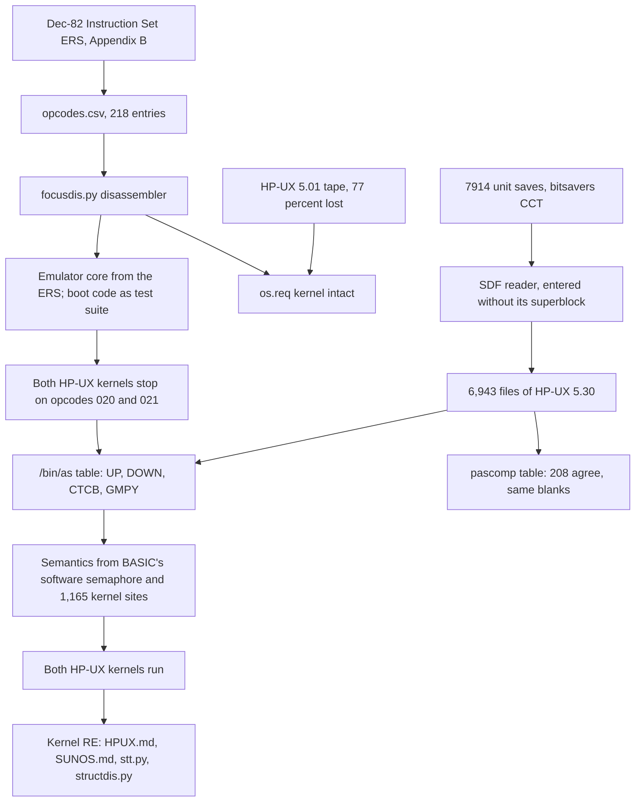

# How we got into the HP FOCUS: a timeline for the blog series

This is the working source for a blog series about the emulator: what was
learned, in what order, and what each step depended on. Every entry cites
the commit that recorded it, and every figure is quoted from that commit's
message or the document it changed. `git show --no-patch <hash>` gives the
full account behind any line.

The short version, which the series should keep straight: **the instruction
encodings came from HP's own 1982 specification, on the first day.** The
HP-UX disc, broken open on the second day, did not supply the encodings. It
supplied HP's own tools, whose instruction tables confirmed the
specification independently and named the four opcodes the specification
leaves blank. Two of those four stopped every HP-UX boot. Naming them was
the step that let the kernels run, and the running kernels are what the
rest of the system was reverse engineered from.

---

## Part 1: Timeline

All dates are commit dates, US Eastern time.

### Before the first commit: the sources

- **Documentation.** Eleven primary PDFs mirrored from
  `bitsavers.org/pdf/hp/9000_500/`
  ([docs/bitsavers/](../bitsavers/)). The two that matter are the **FOCUS
  Instruction Set ERS** (Dec 1982, 150 sheets) and the **FOCUS I/O ERS**
  (Dec 1982, 80 sheets). Both have usable OCR text layers
  ([docs/notes/](../notes/)).
- **Software.** Everything first in hand came from the HP Computer Museum,
  behind a CAPTCHA, fetched by hand. Most of the collection was donated by
  Charlie Brett of Fort Collins, Colorado
  ([software/README.md](../../software/README.md)). It comprised BASIC 2.0
  (7 discs), the BASIC demo suite (7 discs), the 9020 System Functional
  Tests (6 discs), and the museum's HP-UX 5.01 tape, `97089C.hpi`. That
  tape is the only Series 500 HP-UX image known to be public
  ([docs/SOFTWARE.md](../SOFTWARE.md)).
- **What did not exist anywhere:** any FOCUS emulator, or any dump of the
  boot loader ROM.

### 2026-08-17: the specification becomes a disassembler, then a CPU

**`2df093e` (14:00): the opcode map, a disassembler, and the damaged tape.**

- Appendix B of the Instruction Set ERS is a fold-out chart on sheet 137
  giving the bit patterns of all six instruction formats. It was rendered
  at 400 dpi ([docs/notes/appendixB-137.png](../notes/appendixB-137.png))
  and transcribed by hand into [docs/opcodes.csv](../opcodes.csv): **218
  entries.**
- The transcription was checked against an independent derivation.
  `tools/extract_opcodes.py` scrapes opcode assignments out of the
  section 6.2 prose, and `tools/check_opcodes.py` diffs the two. That
  produced **25 conflicts, all of them OCR damage in the prose** (`S8IT`
  for `SBIT`, `IXTT` for `IXIT`, `LOB` for `LDB`). None pointed at an
  error in the chart.
- [tools/focusdis.py](../../tools/focusdis.py) disassembles FOCUS from
  that map. It was validated against real code: the HP-UX 5.01 kernel
  `os.req` and the BASIC boot disc. Doing so settled the format 6 and
  BCCS encoding questions. A C++ disassembler for MAME was differentially
  tested against the Python one over **550,030 instructions**.
- The HP-UX tape was assessed and found to be far worse than the museum's
  note of 47 read errors. It is truncated: the last nonzero block is
  16,315, and **77% of the tape is zero fill**. `SCOMMANDS`, the 8.4 MB
  fileset holding the entire userland, is gone. The kernel `os.req`
  survived whole.
- [tools/modmap.py](../../tools/modmap.py) maps the 16-byte
  space-padded module names in a boot image. Both the HP-UX kernel and the
  BASIC system open with **`SYSTEM POWERUP`**, the module the loader ROM
  jumps to. Two unrelated images sharing that module made it possible to
  cross-reference the loader's handoff contract instead of guessing it.

**`470aafb` (14:56): the execution core runs HP's own example.** ERS
section 7 (sheet 129) gives a recursive factorial in FOCUS machine code.
Assembled from the published listing, it computes 12! = 479001600, with
recursion twelve deep. About 80 of the 218 opcodes were implemented.
`7b7e97e` (20:10) repeats the run inside a real MAME build.

**`6555dba` (21:07) through `59b600d` (23:49): the boot code becomes the
test suite.**

- The disassembler, pointed at both `SYSTEM POWERUP` modules, showed they
  run the same I/O sequence at a constant offset. From then on the method
  was to run the real boot code and let each fault name the next piece of
  work (`6555dba`, `78d79bd`). That method found bugs no unit test had a
  reason to look for: LRA/LRAS pushing absolute addresses, and WTC popping
  its operands.
- `0c0866a` and `a1d55a6`: a brute-force entry-point sweep
  (`bootprobe`) stalled. The media turned out to be the better guide: two
  fields in the disc header distinguish boot discs exactly.
- `5931390`: those fields lead to a boot descriptor at offset 0x400.
  BASIC 2.0 is one 372,932-byte image split across two discs, and
  [tools/bootimage.py](../../tools/bootimage.py) reassembles it into 57
  modules.
- `4567a2a`: the entry point is the module's version-string terminator
  plus 0x1e. **BASIC 2.0 and HP-UX 5.01 begin with the same nine
  instructions there**, which made the result conclusive.
- `83458b3` and `59b600d`: the handoff takes a stack value of -2 (cold
  start) and requires the CPU to be on MPB channel 1. The run ends in a
  checksum loop over data the loader would have supplied.

### 2026-08-18, small hours: getting into the HP-UX image

**`019e65a` (00:14): the mislabelled tapes.** Two images in the
bitsavers Crisis Computer Tapes collection are named
`7914_unitSave_hpux4.0`. Their boot image says "HP-UX Model 530/540/550
Release 05.30 (97089C)", the last release HP shipped for the Series 500.
They are intact, with data to the final block of each. A 611,740-byte
bootable image sits at offset 0x400 of tape 1. The same commit gave a
third `SYSTEM POWERUP` sample that obeys the entry-point rule exactly. It
also re-read `e9c28206` as the boot image format magic rather than a
product identifier (see the sidebar in Part 2).

**`3d06940` (00:22) and `edbded2` (00:39): Linux cannot mount it.**
Series 500 HP-UX uses SDF, HP's Structured Directory Format, for which
Linux has no driver. [tools/discdump.py](../../tools/discdump.py) pulled
out what needed no filesystem: the boot image and the embedded cpio
members, **374 files** across the two tapes. It validates headers rather
than pattern matching: a raw count of the binary cpio magic gave 105 and
444 hits, but only one real member.

**`dc084d6` (00:46): SDF from the manual pages.** The Series 500 `fs(5)`
and `inode(5)` pages document the format, and
[tools/sdfread.py](../../tools/sdfread.py) implements it. It recovers
**206 files from the floppies**, but a byte-by-byte scan of both 7914
tapes finds **no SDF superblock at all**. The commit concluded the unit
save was a backup record format.

**`766fee6` (01:18): the imaging logs settle it, and the superblock was
never there.** The logs record 1024-byte blocks, numbered from 1 to
65,406; 65,406 x 1024 = 66,975,744, the image size to the byte. So the
tapes are raw sector images, and **block 0, the superblock, was never
imaged.** The geometry was confirmed by experiment: 159 of 237 directories
decode under the right block mapping, against 3 for the nearest
alternative.

**`f7ca842` (02:07): entering the volume without its superblock.**
`fs(5)` fixes what lives at the front of the File Attributes (FA) file:
record 0 is the FA file's own i-node, record 1 the root directory. That
pair, a file with no partial last block next to a directory that is its
own parent, **occurs exactly once in 133 MB.** The FA file's extent map
then bootstraps the rest of itself, and the extent total closes exactly on
its declared size, so the extent list is proved rather than fitted. Two
more corrections came with it. Tape 2 is the second half of the same disc
at a different skew, not a second copy. And i-node numbers are FA record
indices directly, with no base offset. Dates come from `inode(5)`'s
encoding of a Julian Day Number plus seconds since midnight.

**Result: 6,943 names (6,062 distinct files and 881 hard links) in 434
directories, 62.9 MB, under their real paths.** `/usr/adm/pacct` last
changed on 1991-08-20 at 17:56, which dates the shutdown of the machine
the tapes came from. [tools/sdf7914.py](../../tools/sdf7914.py) does the
whole extraction. `3050d93` (02:11) applies the same walk fix and date
restoration to the floppies.

### 2026-08-18, afternoon and evening: the opcodes the ERS does not have

**`cc1527c` (14:51): the first stop.** BASIC 2.0 and the diagnostics now
run their whole launch chain. **The HP-UX 5.30 kernel runs 7.7M
instructions and then executes format 4 opcode 021, which the ERS never
assigned.**

**`eca707c` (18:34): both HP-UX versions stop in the same place.** The
5.01 kernel, made bootable by truncating `os.req` at its chain end and
appending the terminator word, boots the same chain. It stops after 1.26M
instructions, in the CORE SYSTEM segment, on format 4 opcodes **020 and
021**, both unassigned in the Dec-82 Appendix B. A byte scan finds them
1,192 times in 5.01 and 1,514 times in 5.30, while BASIC and the
diagnostics never execute either. The 530/540 service manual describes "an
instruction set consisting of 230 operation codes", against the chart's
218. The commit ends: "no assembler mnemonic table survives in the
recovered userland to name them."

**`944fbf1` (19:25): HP's first instruction table, from the Pascal
compiler.** `/usr/lib/pascomp`, recovered from the 7914 tapes, carries
the FOCUS instruction set as an array of 16-byte records: mnemonic, opcode
bits in place, operand class and attribute flags. It is read by
[tools/hptable.py](../../tools/hptable.py).

- **208 assignments agree with the hand transcription, and none
  disagree.** This is HP's machine-readable table checking a transcription
  of a fold-out chart.
- It settles two glyphs that had been adjudicated from the prose: SRSI is
  really **BRSI**, and RPC is really **RFC**.
- It leaves **the same fourteen format 4 slots blank** as the 1982 chart.
- Decoding code segments properly, rather than scanning bytes, gives 746
  uses of 020 and 419 of 021 in the 5.01 kernel. Both appear only in the
  kernel, which points to privileged instructions emitted by HP's internal
  MODCAL compiler, which is not on the tapes.

**`2e7cf37` (20:52): `/bin/as` names them.** The HP-UX 5.30 assembler
carries its instruction set as a flat array of 28-byte records: a
mnemonic-pool pointer, a handler class, the encoding and the operand
syntax. [tools/astable.py](../../tools/astable.py) reads it, and locates
the table itself by fitting the pointer-to-pool displacement.

- **All 202 mnemonics it shares with `opcodes.csv` agree, with zero
  mismatches.** The Appendix B transcription is now confirmed by two HP
  tools independently.
- It names four opcodes that every documentary source leaves blank:

  | Mnemonic | Encoding | Meaning |
  |---|---|---|
  | `UP` | format 4, opcode 020 | semaphore signal |
  | `DOWN` | format 4, opcode 021 | semaphore wait |
  | `CTCB` | format 4, opcode 024 | fits the ERS's Current TCB Pointer |
  | `GMPY` | format 6, opcode 021 | operand syntax `ds` |

- It also spells `SOLC` as "sloc". The ERS prose and the Pascal compiler
  agree on SOLC, so that is HP's typo.
- The disassembler tables were regenerated, so kernel listings read UP and
  DOWN instead of `.word`.

The recovered instructions are written up in
[docs/FOCUS.md](../FOCUS.md) section 10.19.

### 2026-08-18 to 2026-08-20: from a name to a meaning

A mnemonic is not a semantics, and no HP document describes UP or DOWN.

**`583b39b` (Aug 18, 21:06): what the call sites say.** Over all 1,165
sites in the 5.01 kernel:

- the operand is always a pointer, built by LRAS, LRA, CPTR or an ADDI
  field walk;
- 76-86% of sites have no conditional branch within five instructions, so
  the wait happens in microcode and involves the dispatcher;
- every DOWN sits inside an `INT,B ... INT` bracket, as a kernel
  semaphore acquisition would.

The commit kept both opcodes trapping: "A guessed P/V that quietly
schedules wrong is worse than one that stops."

**`b7fe909` (Aug 19, 00:10): the software twin.** The BASIC kernel
implements the same primitive in software, in the routine at 0x45720 of
the diagnostics environment and the dispatcher that serves it. Decoding
that machinery fixed every convention the microcode must share with the
OS. A semaphore is two words: a wait-list head that doubles as the
multiprocessor lock, and a count. HP-UX's own operands carry `{0, 1}`, an
unlocked one-unit mutex. With UP and DOWN implemented to match, **HP-UX
5.01 runs to a correct idle with zero traps and zero panics.**

**`f49592f` (Aug 20, 15:12): both kernels reach their idle.** HP-UX
5.01 and 5.30 both boot from cold to the dispatcher idle with no traps.
Two fixes got them there: program pointers carry flags in their top two
bits, and DOWN accepts absolute addresses.

**`705798c` (Aug 20, 16:44): the `,B` bit, settled from the kernels' own
data.** The plain form names the semaphore with a data segment pointer
and the `,B` form with an absolute address. The 5.01 kernel uses 574 UP,
303 DOWN, 172 UP,B and 116 DOWN,B. HP-UX's unit semaphores, read as
pointers, land on three 24-byte semaphore blocks in segment 15, the same
structure BASIC's kernel builds. Read as absolute addresses, they land on
untouched memory, which is why two tasks had parked forever.

In parallel, BASIC reached its banner on the 520 (`dcb01d5`, Aug 20,
02:46: "BASIC Ready for use.").

### 2026-08-20 to 2026-08-29: reading the system off the running kernel

With the CPU right, the work moved to finding what the kernel expects of
the hardware. Almost all of that came from disassembly and runtime traces,
not documentation.

- **`ac236c6` (Aug 22): the 540 prints on its console** — a full panic
  report. [docs/HPUX.md](../HPUX.md) begins here, "a working map of the
  kernel ... Everything here was read off the running system or the
  disassembly; nothing in this file comes from documentation." It arrives
  with the kernel-reading tools [tools/segdump.py](../../tools/segdump.py),
  [tools/structdis.py](../../tools/structdis.py),
  [tools/escmap.py](../../tools/escmap.py) and
  [tools/panicdump.py](../../tools/panicdump.py).
- **Aug 22 to 26: the console hunt.** Seventeen `Console:` commits,
  sixteen of them on Aug 22 alone, trace why HP-UX's console open never completes, with theories proposed
  and retracted in the open (`54ea71e`, `f0061fe`). `97fdc39` (Aug 25):
  the serial card must count only the data phase as the "length of data
  transfer", and **HP-UX 5.30 prints its banner.** `9edaf5c` decodes the
  driver's submit-with-callback design, and `65d6284` (Aug 26) fixes the
  console drain.
- **`4e712a0` (Aug 24): the Segment Transfer Tables are the interface.**
  Every transfer between FOCUS code segments goes through a Segment
  Transfer Table (STT). A segment's own table is therefore the list of
  entry points it publishes, and external entries are calls into other
  segments. [tools/stt.py](../../tools/stt.py) reads the whole
  inter-segment interface out of a boot image without running anything.
  [docs/SUNOS.md](../SUNOS.md) applies it to SUN OS, the kernel under
  BASIC: 383 published entry points, 126 called from elsewhere, 271
  references in all.
- **`dd0684b` (Aug 26): the graphics command set was in the boot image
  all along.** Nothing in the collection documents the 520's display
  interface. The PWP SELF TEST segment, at 3,712 bytes the smallest in the
  image, is HP's power-up test for the display, and it names every command,
  parameter count and memory size. Listings live in
  [disasm/](../../disasm/README.md).
- **`b6aa91f` (Aug 28): HP-UX 5.30 boots to the single-user shell.**
  `init`, `/bin/sh` and `/etc/profile` run, with commands exec'd from the
  7914 image and paged through swap. Ten defects were found between device
  configuration and the `TERM = (network)` prompt (HPUX.md section 9).
- **`0152def` (Aug 29): multiuser.** A root login on every port of an HP
  27140A six-channel multiplexer, after in-place edits to the SDF volume
  by [tools/hpuxconfig.py](../../tools/hpuxconfig.py).
- **`c9b7f0f` (Aug 29): HP-UX 5.01 reaches its banner on the 520**,
  built from the damaged museum tape by
  [tools/hpuxboot.py](../../tools/hpuxboot.py). The tape holds two 5.01
  kernels, and only the 520's survives intact.

### Epilogue: 2026-10-26

**`22370c9`: the emulator becomes an ordinary MAME driver**, `hp9k520`
and `hp9k540` on the `hp9k5xx` branch of the `mame/` submodule, with
[tests/run_tests.py](../../tests/run_tests.py) driving every boot
milestone headless. **`5eb243a`** adds the disassembler's differential
test against MAME's `unidasm`.

---

## Part 2: The process, as a dependency chain

Why each step needed the one before it:

1. **The specification had to come first, because it was the only source of
   encodings that existed.** No FOCUS emulator, assembler listing or
   disassembler survived anywhere. The ERS chart gave 218 opcodes, and a
   hand transcription checked against the OCR prose was good enough to
   disassemble real code on day one.
2. **The disassembler validated the map before the CPU was trusted.**
   Running it over the 5.01 kernel and the BASIC boot disc confirmed that
   the map decoded real code sensibly. It then became the instrument for
   everything after: reading `SYSTEM POWERUP`, finding the entry rule, and
   reading boot images.
3. **The emulator found the gap.** The two opcodes missing from the chart
   were invisible to static reading; a disassembler simply prints `.word`
   and moves on. They became a blocker only when a CPU built from the ERS
   ran both HP-UX kernels into them.
4. **Only the HP-UX disc could fill the gap.** The 5.01 tape had lost its
   userland, and the 1982 ERS predates the opcodes. The answer had to be in
   a shipped HP tool, and the only surviving userland was on the 7914 unit
   saves, behind a filesystem nothing modern could read and missing the
   block that describes it. Breaking into that disc is the hinge of the
   whole story.
5. **HP's tables gave names and encodings, not behaviour.** The Pascal
   compiler confirmed the chart but had the same blanks. The assembler
   named the four missing opcodes. What UP and DOWN actually do came from
   two other sources: the BASIC kernel's software implementation of the
   same semaphore, and statistics over the kernels' own call sites.
6. **A running kernel is what made the rest of the system legible.** Once
   both kernels ran, each stall pointed at a specific driver expectation,
   and the disassembly and runtime traces of the kernel became the main
   documentation of the hardware (HPUX.md), the system call surface
   (SUNOS.md and `stt.py`) and even the graphics card (the PWP SELF TEST
   segment).

### Sidebar: conclusions that were recorded, then retracted

The commit log keeps its wrong turns, and they make some of the best
material for the series.

- **`e9c28206`: a checksum, a product identifier, or the format magic?**
  `59b600d` (Aug 17) ruled it out as a checksum and called it a product
  identifier. `019e65a` (Aug 18) found the same value on the BASIC discs
  and the HP-UX disc, so it is the boot image format magic.
- **"A unit save is a backup record format."** `dc084d6` concluded this
  from finding no superblock. Thirty-two minutes later `766fee6` showed
  from the imaging logs that the tapes are raw sectors and block 0 was
  never imaged.
- **"The two tapes are separate volumes", and "the FA base".** `766fee6`
  read the tapes as two volumes, and fitted a constant stride as an i-node
  base. `f7ca842` showed they are one volume spanning both reels at
  different skews, that i-node numbers index the FA file directly, and
  that the stride was only the spacing of the FA file's own extents.
- **"No assembler mnemonic table survives."** Written in `eca707c` at
  18:34 on Aug 18. `/bin/as` named the opcodes at 20:52 the same evening
  (`2e7cf37`).
- **How UP and DOWN name their semaphore.** `b7fe909` read an absolute
  address as a pointer with segment number zero. `f49592f` switched to
  testing the pointer's tag. `705798c` settled it from the kernels' data:
  the `,B` bit selects absolute versus segment pointer, and reading every
  operand one way "was wrong in both directions".
- **Smaller ones worth a line:** the floppy volume header field at 0x1c is
  a block size, not a directory pointer (`dc084d6`); continuation boot
  volumes all start at 0x800, not where a descriptor field seemed to say
  (`cc1527c`); and in the console hunt, "the driver never issues a CLC"
  (`2baffc6`) was retracted in the next commit (`f0061fe`).

---

## Part 3: Proposed series outline

Six posts. Each lists the commits to draw on, the documents and tools to
quote, and the figures worth including.

### 1. The machine and the paper trail

FOCUS (1982) as the first commercial 32-bit microprocessor: microcoded,
segmented, stack-oriented, the HP 3000 architecture widened to 32 bits.
What survives of it is bitsavers documentation, the museum's media, and no
emulator. The post covers transcribing Appendix B and checking it against
the OCR prose.

- Commits: `2df093e`.
- Quote: [README.md](../../README.md),
  [docs/SOFTWARE.md](../SOFTWARE.md), [docs/FOCUS.md](../FOCUS.md).
- Figures: [docs/notes/appendixB-137.png](../notes/appendixB-137.png), and
  a few rows of [docs/opcodes.csv](../opcodes.csv) next to the chart.

### 2. A disassembler before an emulator

Validating the map against a kernel from a 77%-lost tape. `SYSTEM POWERUP`
as the shared entry point of two unrelated systems. The factorial from ERS
section 7, then using real boot code as the test suite: the nine identical
instructions at terminator + 0x1e, and the bugs only real code found.

- Commits: `2df093e`, `470aafb`, `7b7e97e`, `6555dba`, `78d79bd`,
  `5931390`, `4567a2a`, `83458b3`.
- Quote: [software/README.md](../../software/README.md) on the tape
  damage and the module format.
- Figures: the damage table for `97089C.hpi`; a `focusdis.py` listing of
  the nine entry instructions from both images side by side.

### 3. Breaking into the HP-UX disc

The mislabelled "hpux4.0" tapes that turned out to hold HP-UX 5.30. SDF,
which nothing modern reads. A reader written from the `fs(5)` man page.
The superblock that was never imaged, and the File Attributes file that
describes itself, a pair occurring once in 133 MB. Dates from Julian Day
Numbers, and the machine's last shutdown on 1991-08-20.

- Commits: `019e65a`, `3d06940`, `edbded2`, `dc084d6`, `766fee6`,
  `f7ca842`, `3050d93`.
- Quote: [software/README.md](../../software/README.md) sections
  "SDF, decoded", "Entering the volume without its superblock" and "The
  dates"; [tools/sdf7914.py](../../tools/sdf7914.py).
- Figures: a diagram of the FA file bootstrapping its own extent map; a
  directory listing of the recovered `/bin` and `/usr/lib`.

### 4. Asking HP's own tools

Both kernels stop on two opcodes the 1982 chart leaves blank, and the
service manual says there should be 230 opcodes. The Pascal compiler's
16-byte records: 208 agreements, two glyphs corrected, the same blanks.
The assembler's 28-byte records, located by fitting pointer displacements:
UP, DOWN, CTCB, GMPY, and HP's "sloc" typo. Two HP tools confirming a hand
transcription independently.

- Commits: `cc1527c`, `eca707c`, `944fbf1`, `2e7cf37`.
- Quote: [docs/FOCUS.md](../FOCUS.md) section 10.19;
  [tools/hptable.py](../../tools/hptable.py) and
  [tools/astable.py](../../tools/astable.py).
- Figures: a hex dump of a few `/bin/as` records with the fields labelled;
  a kernel listing before and after (`.word` versus `UP`/`DOWN`).

### 5. From a name to a meaning

Inferring UP and DOWN without documentation: statistics over 1,165 call
sites, the INT bracket around every DOWN, and the decision to keep trapping
rather than guess. The BASIC kernel's software semaphore as a Rosetta
stone. The `,B` bit, settled by what the operands actually point at.

- Commits: `583b39b`, `b7fe909`, `f49592f`, `705798c`.
- Quote: [docs/FOCUS.md](../FOCUS.md) section 10.19 (the semantics), and
  the "wrong in both directions" passage of `705798c`.
- Figures: the two-word semaphore layout and the wait-link node at
  `CTCBP-8`; the software routine at 0x45720 next to a kernel DOWN site.

### 6. Reading the kernel

What a running kernel makes legible. The console hunt, with its retracted
theories, ending in a one-field fix to the serial card's transfer length.
STTs as the system call interface. The graphics command set found in a
self-test segment. Single-user shell, then multiuser logins on a 27140A,
then 5.01 on the 520 from the damaged tape. Epilogue: the MAME driver.

- Commits: `ac236c6`, `97fdc39`, `9edaf5c`, `65d6284`, `4e712a0`,
  `dd0684b`, `b6aa91f`, `0152def`, `c9b7f0f`, `22370c9`.
- Quote: [docs/HPUX.md](../HPUX.md) (its opening paragraph, section 6b "The
  hunt, as it was recorded before the answer", and section 9);
  [docs/SUNOS.md](../SUNOS.md) section 1.
- Figures: the `stt.py --graph` call graph; listings from
  [disasm/](../../disasm/README.md); screen dumps of the HP-UX banner, the
  `TERM = (network)` prompt and the multiuser `who`.
